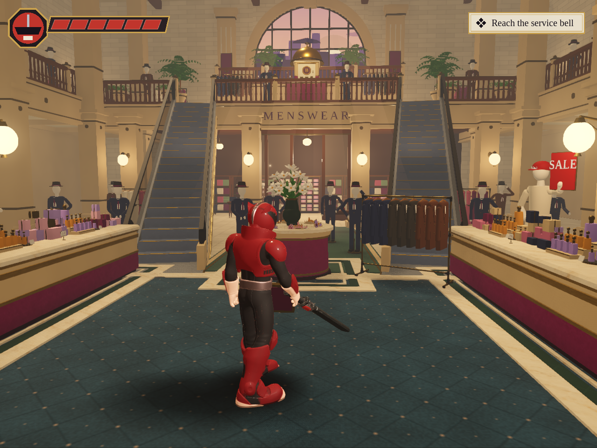

# Atrium stonework pass — 29 October 2026

Base: `afterbell-greybox` at `66445bc6a537a7b959e3f9d82927ce2f496d8e03`.
Working branch: `afterbell-atrium-polish`. No changes to main or to CAW Helper.

## Findings and choice

The current baseline is substantially beyond the old images in `docs/look/`. A fresh
1280×960 Forward+ capture is the baseline for this review. The active `deco` look,
reference-matched camera, teal carpet, cream/plum counters, escalators, MENSWEAR
mezzanine and great bell are preserved. The original external painting is not in
this checkout; the written reference descriptions and actual checked-in images
were available. No claim of a pixel match to that absent reference is made.

The three most visible remaining weaknesses in the captured gameplay view:

1. **Architectural finish:** large square column shafts and stacked box capitals
   read as blockout geometry beside the better-finished counters and escalators.
2. **Display repetition:** repeated identical suit forms and evenly spaced stock
   make the foreground-to-background progression feel mechanically populated.
3. **Tonal separation:** large cream surfaces sit in similar warm midtones;
   lighting and haze flatten some architectural depth. This needs selective
   lighting/material work, not another indiscriminate global contrast increase.

The first issue is addressed here. Columns repeat through the whole composition,
so an improved shared column benefits the court, arrival and title views without
moving any gameplay object or obstructing the lane to the bell.

## Implemented

- Cached bevelled stone bases, shaft corners and capitals replace sharp boxes.
- Three shallow stopped flutes on each face articulate the long shafts; narrow
  stone arrises catch existing light. Relief uses two existing-style materials,
  with no additional lights, textures, shadow-casting detail or dependencies.
- The same maximum base footprint and structural heights remain. Collision,
  objectives, room connections, camera constants, combat timings, racks, lever,
  bell, cabinet and characters are unchanged.
- The corner segment count is reduced to two for these small stone bevels.
- Fixed `Props.rounded_block` caching: `seg` now participates in the cache key.
  Previously two requests of equal dimensions and different tessellation shared
  whichever mesh was built first. Default five-segment furniture is unchanged.
- Added six rendered geometry assertions covering cache identity, tessellation
  reduction, one-surface construction, footprint and bottom-origin conventions.
- `ref_shot.gd` saves renderer counts beside its image, rejects headless capture,
  checks scene initialization on the first frame and fails on PNG-write errors.
- Release checks include rendered geometry tests and respect an existing DISPLAY.

## Wider technical audit

| Area | Finding / risk | Priority / action |
|---|---|---|
| Geometry | Block-like shared supports; detail already substantial elsewhere | Addressed supports; next improve selected storefront modules |
| Lighting | Warm haze reduces depth; frosted globes clip white in this view | Medium: local light/exposure test, preserve lifted shade |
| Materials | StandardMaterial3D throughout; no custom shader files found. Metals reflect background colour, with SSR disabled and no authored reflection probe in atrium builder | Medium: bounded reflection/material study, measure any probe cost |
| Composition | Strong bell/window axis; repeated suit silhouettes compete with the lily table and escalator feet | High: curate display poses/spacing in the existing footprints |
| Animation | Runtime Mixamo/keyframe retargeting, speed matching and pose blending already present. Headless tests verify clip timing, not animation quality | Real-time controller and animation review still needed |
| Camera | Dedicated court framing and room squeeze logic already exist | Preserve; test moving boss/near-wall views interactively |
| Gameplay | Six existing suites cover reflection, boss phases, doors, rack stops, checkpoints and path reachability | All baseline suites pass; preserve these contracts |
| Performance | Static material/cell batching and shadow exclusions already active; frame still submits ~2M primitives from this view | Retain batching; measure target hardware before increasing lighting cost |
| Code | Runtime-generated geometry, hand-authored 2D collision and cached material/mesh identity require careful separation | Fixed segment cache identity; other systems not rewritten |
| Validation | Old documentation images do not describe latest state; no screenshot metrics previously stored with ref_shot | Added matched before/after captures and JSON counts |

This is a source and automated-test audit with a rendered atrium review, not a
certification of the complete game's real-time feel, audio or every camera angle.

## Open-source evaluation

Reviewed upstream repository metadata and documentation on this date. Nothing
below is installed or copied into the game. Licences on upstream tools do not
implicitly license their optional marketplace or generation-service assets.

| Repository | Licence / requirements observed | Decision for this pass |
|---|---|---|
| [blender-mcp](https://github.com/ahujasid/blender-mcp) | Renamed to [mcp-for-blender](https://github.com/ahujasid/mcp-for-blender); MIT; requires Blender/addon and Python/uv MCP server | No Blender session here; native mesh helper already solves this change |
| [blender-kiln](https://github.com/elithril/blender-kiln) | MIT; Blender 4.4+ and running Blender MCP, tested upstream on newer Blender; optional services/tools separate | Adds tooling without a demonstrated benefit to this bounded procedural pass |
| [material-maker](https://github.com/RodZill4/material-maker) | MIT; standalone Godot-based procedural texture/painting tool | Existing authored texture sets sufficient; revisit for a specific missing material |
| [godot-demo-projects](https://github.com/godotengine/godot-demo-projects) | MIT; upstream master targets development engine, stable-version branches required | Reference only; no need to vendor a demo project |
| [GDQuest TPS](https://github.com/gdquest-demos/godot-4-3d-third-person-controller) | Code MIT; art CC-BY-NC-SA 4.0; current project declares Godot 4.7 | No art reuse; replacement controller would invalidate established combat/movement contracts |
| [phantom-camera](https://github.com/ramokz/phantom-camera) | MIT; current README targets Godot 4.4+ | Current release not a drop-in Godot 4.3 choice; existing court camera retained |
| [limboai](https://github.com/limbonaut/limboai) | MIT code, demo art CC-BY 4.0; current release newer engine, 1.2–1.3 listed for Godot 4.3; native extension/module | No demonstrated AI problem requiring migration |
| [godot-jolt](https://github.com/godot-jolt/godot-jolt) | MIT native extension; README lists 4.3–4.6, built-in integration from 4.4 | Current gameplay collision is manually resolved in XZ; swapping physics engines would not improve it |

## Reproduction

Use Godot **4.3 stable**, Forward+, 1280×960, the default settings, and the same
clean clone (without optional `assets/imports/` models):

```sh
godot --headless --editor --path afterbell-godot --import
godot --path afterbell-godot -s res://tools/ref_shot.gd -- --out=/absolute/path/shot.png
GODOT=/path/to/godot bash afterbell-godot/tools/release_check.sh
```

The captured pose is Ren at `(0, -4.2)`, looking toward the mezzanine, with the
boss hidden by the existing reference tool. It is a staged gameplay-camera shot,
not a screenshot of a human play session. Images are actual engine captures.
`before.json` and `after.json` retain counts for that exact view; `perf_probe` uses
a different moving camera and its older counts are not directly comparable.

The container uses llvmpipe software Vulkan and a TCP Xvfb display. No hardware
FPS target, GPU frame-time improvement, Windows executable validation, new export,
new campaign room or complete-game polish is claimed. Existing baseline captures
also report ObjectDB/resource cleanup warnings at shutdown; not fixed here.

## Next three tasks

1. Curate mannequin poses and stock groupings around the lily-table/escalator view,
   within existing collision footprints; compare court and arrival cameras.
2. Separate the bell, shop interior and cream architecture using local lighting
   and material tests; evaluate a single bounded reflection probe only if useful.
3. Capture a moving full encounter and measure Medium/Low on modest PC hardware;
   prioritize remaining shadow submissions/geometry from that evidence.

## Matched-camera results

| Metric | Baseline | Final | Change |
|---|---:|---:|---:|
| Draw calls | 459 | 461 | +2 (+0.44%) |
| Rendered primitives (triangles) | 2,005,642 | 2,068,714 | +63,072 (+3.14%) |
| Light nodes | 64 | 64 | +0 (+0.00%) |

The initial five-segment candidate submitted 2,091,178 primitives. The final two-segment
version removes 22,464 of those submissions at the same draw count. This is a
visual-quality change with a small geometry cost, not a performance-speedup claim.
The 64 light nodes are existing scene lights, including inactive/hidden nodes;
the number is not a count of lights affecting each pixel.




## Validation completed

- Baseline: all six original suites pass, 108 assertions total.
- Final: `tools/release_check.sh` PASS: the six original suites, the new
  six-assertion rendered geometry suite, 55 asset paths and all six rendered
  scene loads (title, Cosmetics, Hats, Alterations, court, asset staging).
- Fixed-camera baseline and final captured with Godot 4.3 Forward+; final
  image visually reviewed at full resolution.
- `git diff --check` and `bash -n tools/release_check.sh` pass.
- Capture's intentional headless rejection tested (exit 1).
- No Linux/Windows export, interactive controller/audio session or real-hardware
  performance test was run. No independent external reviewer was used.

The dummy headless renderer produces existing null-mesh diagnostics in some
suites; the assertions pass with no GDScript errors. The rendered release gate
also passes. Raw capture PNG SHA-256 values are in `validation.json`.
